# Smart Organizer

English | [Español](README.es.md)

Smart Organizer keeps a folder such as Downloads or the Desktop tidy. It shows
where every file would go before touching anything, moves only what you approve,
and records each batch so you can undo it.

It is a native Windows desktop app written in Rust. It works offline, has no
account, and sends nothing anywhere.

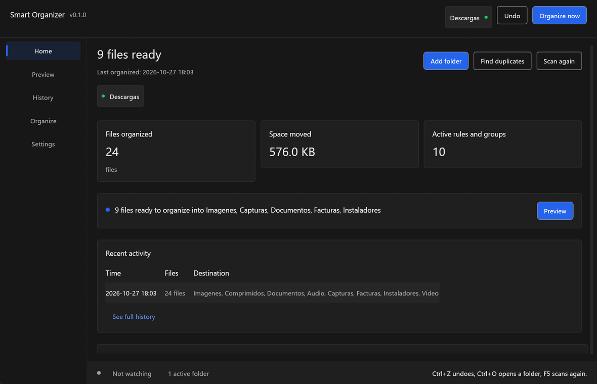

## Screenshots

The screenshots use a fictitious folder, `C:\Users\Public\Smart Organizer Demo`.
No personal paths or documents appear. The tray menu is drawn by Windows and
uses the system theme; the app itself is dark in every screenshot.

| Spanish | English |
| --- | --- |
| 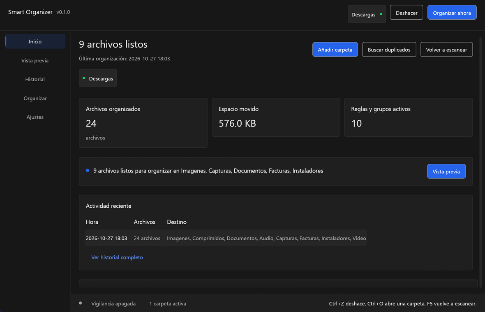 |  |
| 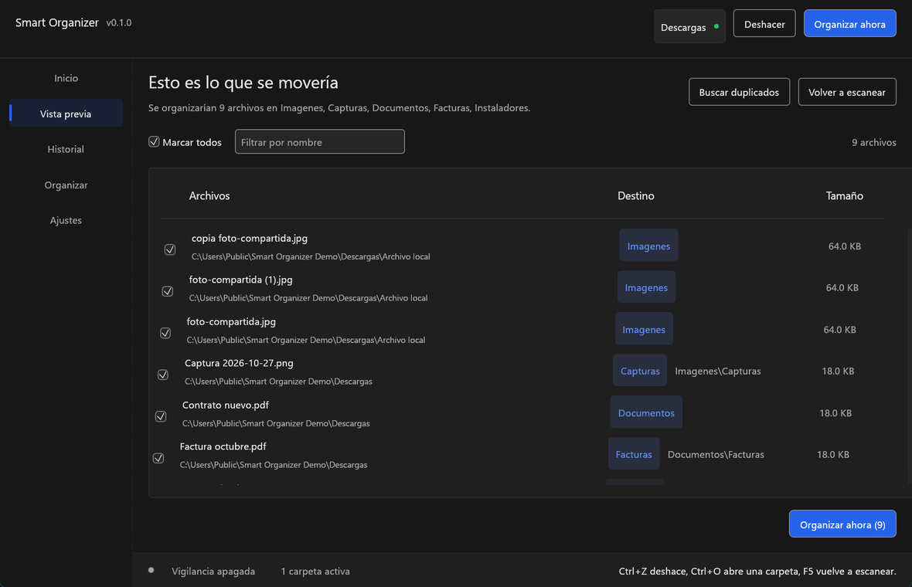 | 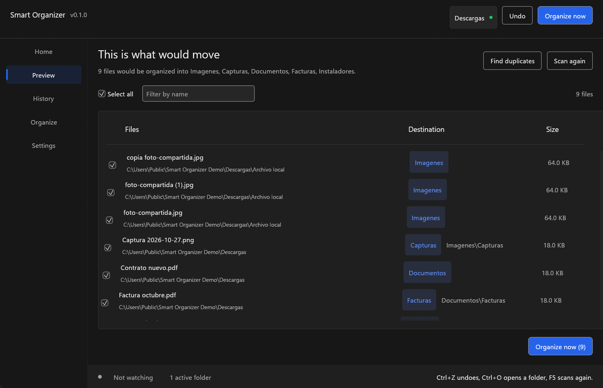 |
| 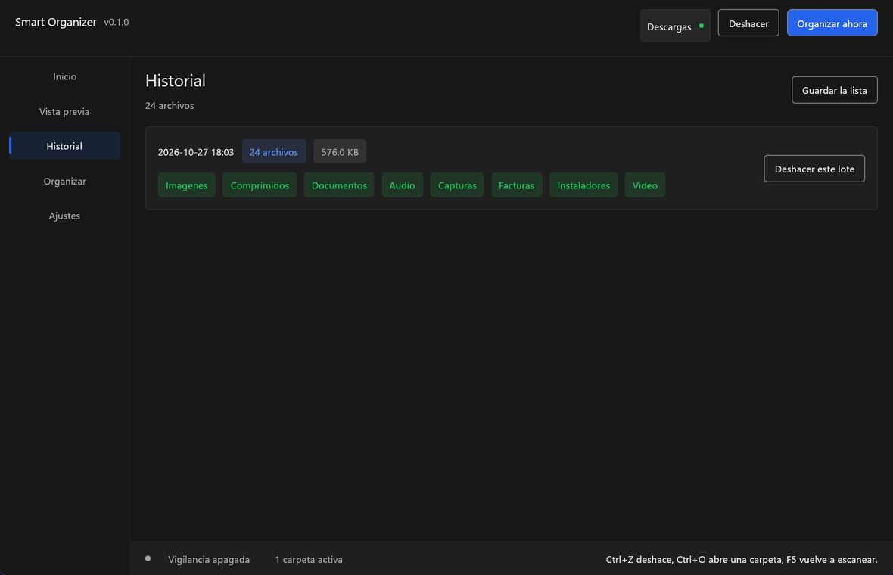 | 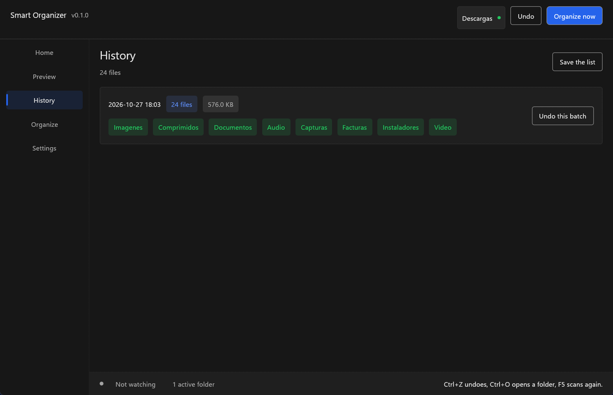 |
| 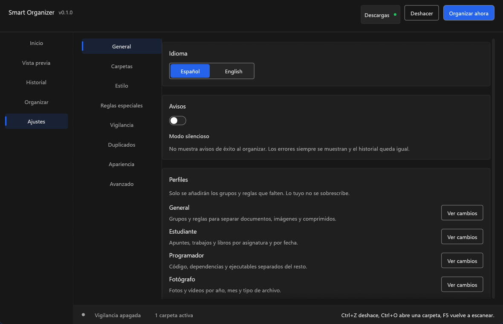 | 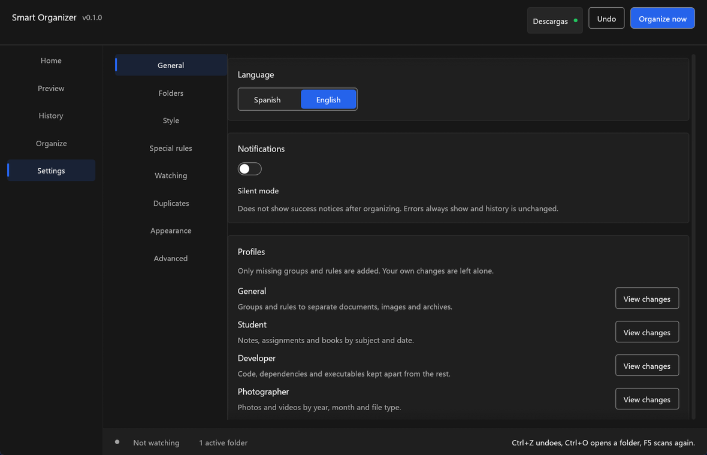 |
| 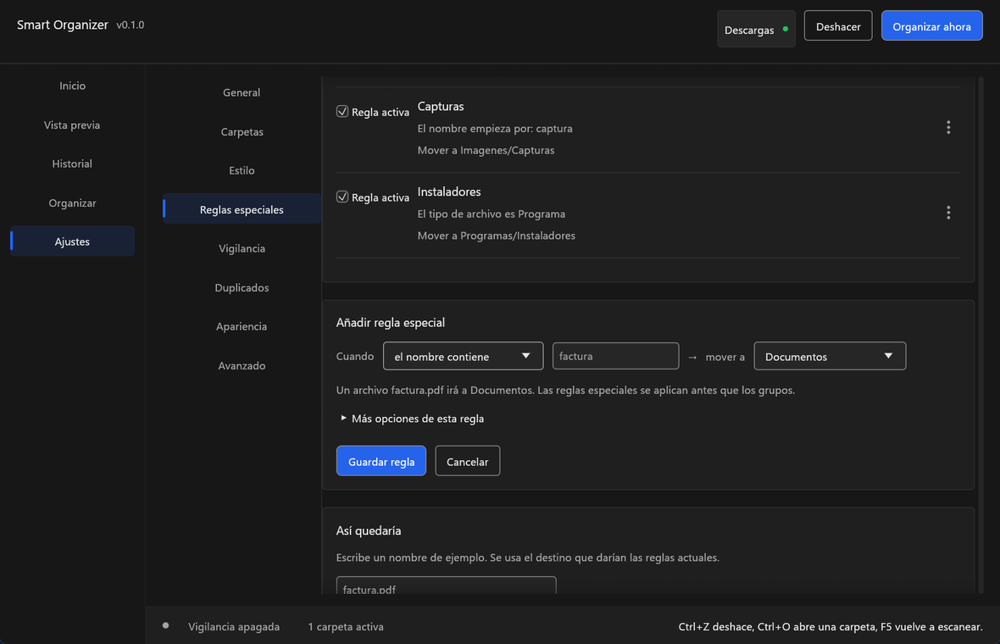 | 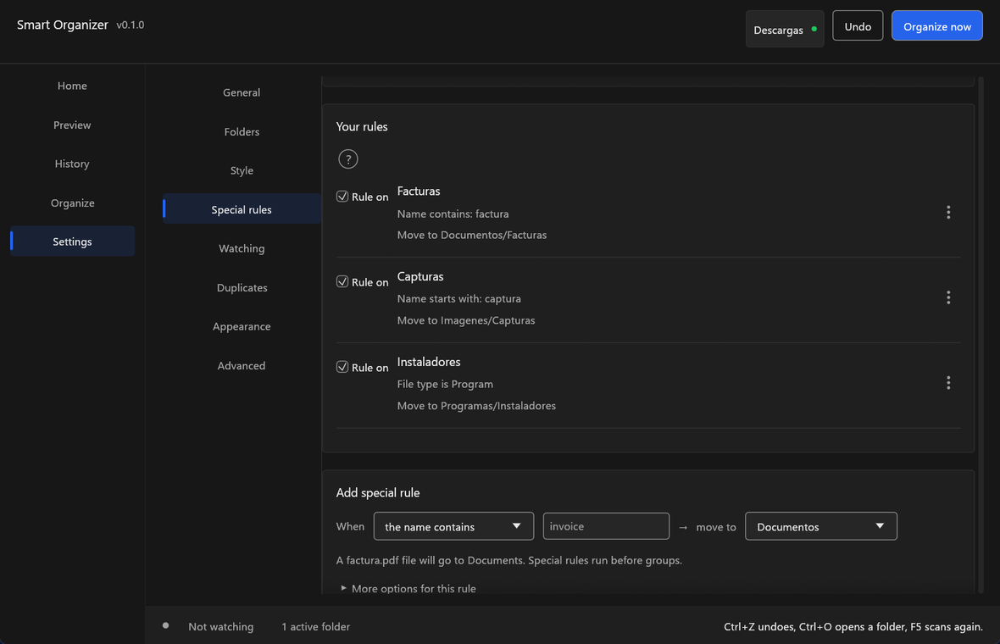 |
| 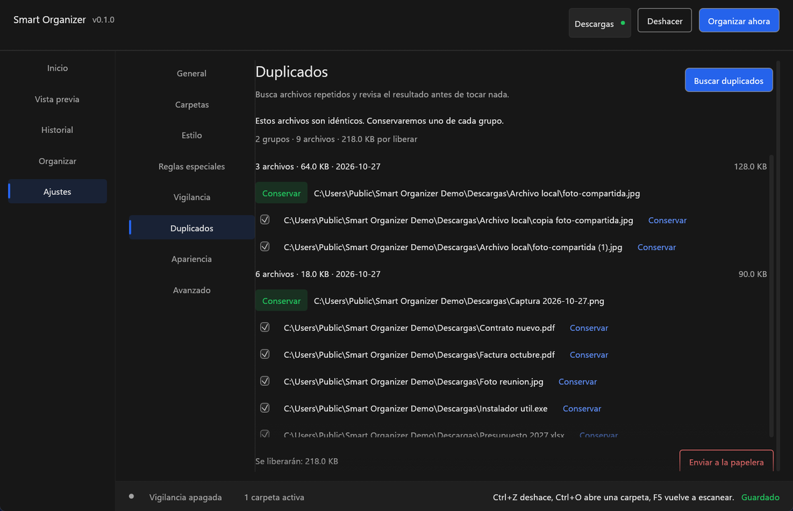 | 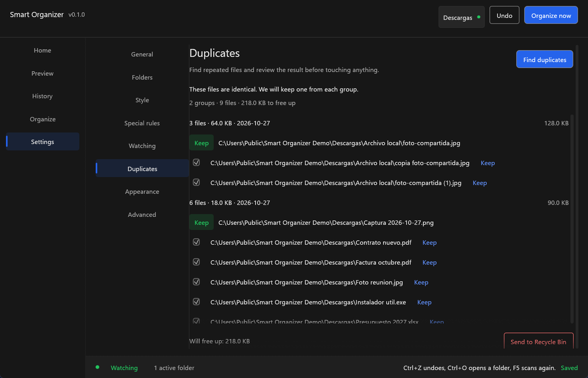 |
| 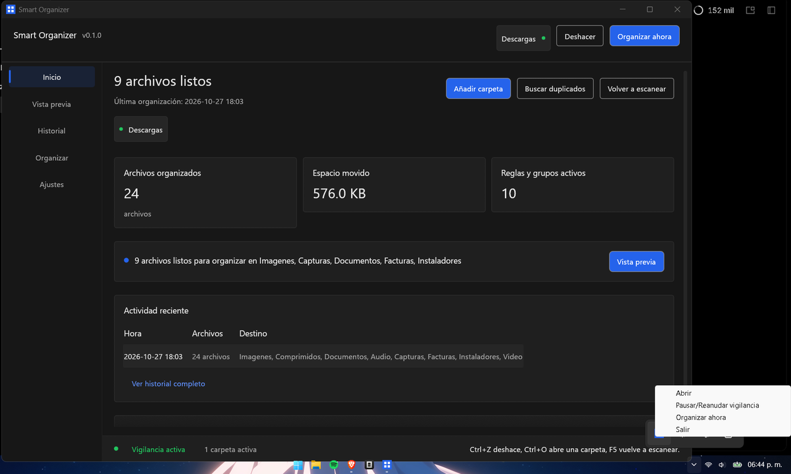 | 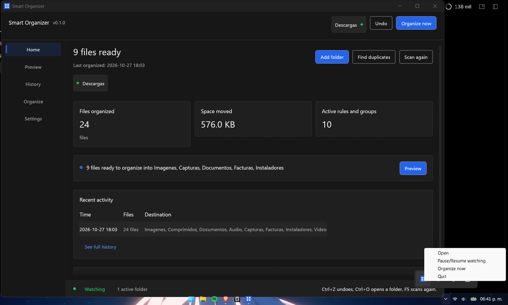 |
| 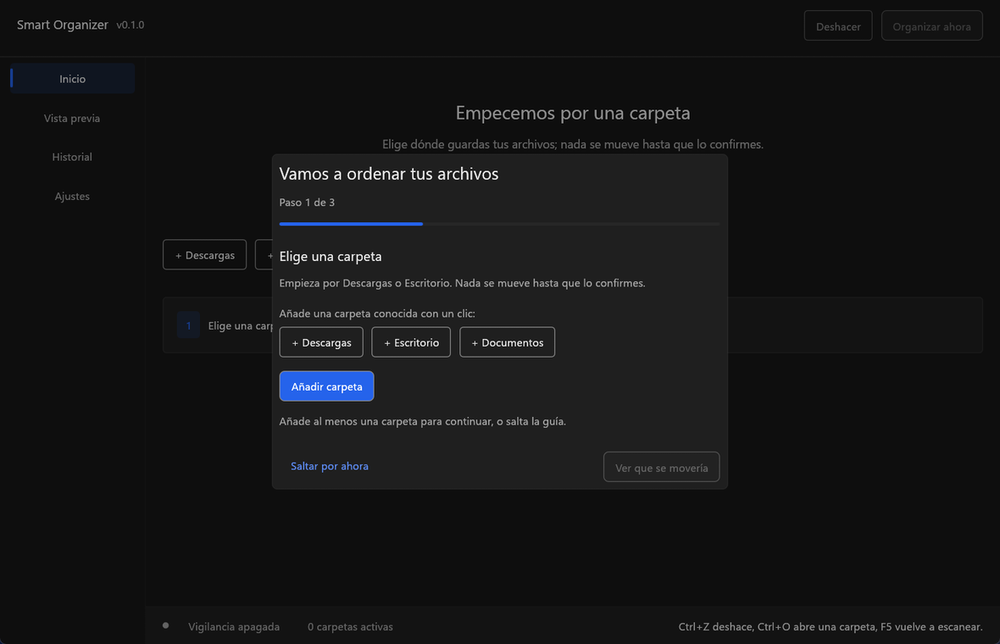 | 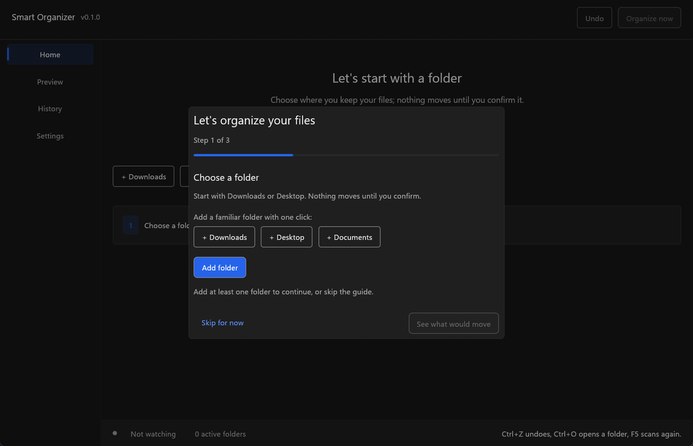 |

### Empty state and appearance

| View | Screenshot |
| --- | --- |
| Empty Home in Spanish, with a red accent and shortcuts to Downloads, Desktop and Documents |  |
| Settings > Appearance in Spanish, with a red `#ff0000` accent and an AA contrast warning |  |

## Features

- **Preview first.** The app builds a plan with the destination of every file.
  You can include or exclude rows; nothing moves until you press Organize now.
- **Undo.** Every batch is written to a journal. Home and History can undo the
  last batch, including files sent to the Recycle Bin by a rule.
- **Eight starter groups.** Documents, Programs, Compressed files, Images,
  Videos, Music, Projects and Other. Each group can be renamed, reordered,
  recolored, given its own destination folder and have its extensions edited.
- **Sentence rule builder.** Read and write rules as a sentence:
  `When [the name contains] [invoice] → move to [Documentos]`.
  Advanced mode adds more conditions, multiple conditions per rule, per-folder
  rules, copy/ignore/trash actions and optional per-type subfolders.
- **Profiles.** General, Student, Developer and Photographer profiles add only
  missing groups and rules. They show a preview first, never overwrite a group,
  and can be undone.
- **Folder shortcuts and drag and drop.** Add Downloads, Desktop or Documents
  directly, drop a folder anywhere in the window, or drop a file to add its
  containing folder. The shortcuts follow OneDrive folder redirection.
- **Duplicate finder.** Scans the chosen folders on demand, groups by size,
  compares the beginning and end of candidates, then computes a full BLAKE3
  hash for real candidates. You choose which copy to keep; the rest can go to
  the Recycle Bin and can be undone.
- **Watcher, tray and autostart.** A separate process watches for new files.
  It debounces changes, waits for file size to stabilize, and organizes only the
  files that changed. Closing the window while watching hides it to the tray.
  Autostart launches the hidden watcher at sign-in, not the window. A failed
  organization pass is caught and logged instead of ending the watcher. The GUI
  restarts a crashed watcher with 1 s, 2 s, 4 s, 8 s and 16 s delays, at most
  five attempts in ten minutes; after that it shows a warning and stops retrying.
  **Restart watching** is available in Settings > Watching, Home, the simple
  view and the tray.
- **Single instance.** A second launch focuses the existing window and exits.
  A second watcher exits silently. The lock is scoped to the data folder, so an
  installed copy and a portable copy can run side by side.
- **Bilingual, accessible UI.** Spanish and English, dark and light themes,
  accent color, three text sizes and two densities. All visible strings go
  through `src/i18n.rs`; controls have keyboard focus and visible focus states.
  Custom switches expose a switch role and their on/off state, and collapsible
  group rows expose a disclosure role and their expanded state. Focus outlines
  use the chosen accent and controls are reachable with Tab.
- **Import, export, backup and reset.** Settings can be exported and imported
  from Settings. The data folder, journal and config file are ordinary local
  files. Reset is explicit and reversible by restoring a backup.

## Safety

- The default action is **move**, not delete. Files that match no group stay put.
- The Recycle Bin is used only when you choose a rule with the Trash action or
  when you explicitly send chosen duplicates to the Recycle Bin. There is no
  permanent-delete button.
- Duplicate cleanup verifies that the copy you keep still exists and that its
  full hash matches every copy before sending anything to the Recycle Bin.
- Hidden files, temporary download fragments (`.part`, `.crdownload`, `.tmp`),
  symlinks and protected system folders are skipped. The scanner stays inside
  the folder you added.
- Duplicate scans ignore offline OneDrive placeholders and 0-byte files, so they
  do not force a cloud download or produce meaningless groups.
- The journal is written before files are moved. On startup, every pending entry
  is checked against the disk. If the source is missing and the destination
  exists, the move is marked complete. If the destination is missing, it is
  marked interrupted. If both exist, the app compares size and BLAKE3, marks the
  entry **needs review**, deletes nothing and warns in History.
- A failed watcher pass is written to `error.log`; the journal is repaired
  before the next pass. A panic during the GUI or `--watch` startup is also
  written there with its trace.
- Settings are saved to `config.toml.tmp`, synced, and atomically replace the
  current `config.toml`. The previous file is copied to `config.toml.bak` first.
  Before a version migration, `config.toml.v{version}.bak` is created once and
  never overwritten.
- The app makes no network requests and has no telemetry.

## Start in three steps

1. **Add a folder.** Press **Add folder**, pick Downloads or Desktop, or drop a
   folder onto the window. The three shortcuts resolve the real Windows folder,
   including OneDrive redirection.
2. **Review the preview.** Open **Preview** and check the source, destination and
   size of each file. Uncheck anything you want to leave alone.
3. **Organize and verify.** Press **Organize now**. The batch appears in
   **History**; if something is wrong, press **Undo** before doing more work.

The first-run guide offers the same path and can be skipped.

## Download and install

The current release is in [`dist/`](dist/):

- `Smart Organizer.exe` — GUI (and hidden watcher mode).
- `smart-organizer-cli.exe` — command-line build for automation.
- `SHA256SUMS.txt` — SHA-256 of every file in the release.
- `README.txt` / `LEEME.txt` — short English and Spanish instructions.

There is no installer and no administrator requirement. Copy the executable to
a folder you control and run it. To keep settings beside the executable, create
a folder named `portable` next to the executable before starting it; the app
then stores `config.toml` and `journal.jsonl` there. See
[Portable mode](#data-portable-mode-backup-and-reset).

The executable is not code-signed yet. Windows may show a SmartScreen warning;
check the hash below before choosing **More info > Run anyway**. A matching
SHA-256 proves that the file is the one whose hash the author published and that
it was not corrupted in transit; it does **not** prove that the program is safe
or that the author is trustworthy.

**TODO:** add the public download/release URL when the project is published.

### SHA-256

```text
77CF5BB77DBAC252056A7E793EF7C4E366025C688D6068497A9CF1EA1D4B767E  Smart Organizer.exe
8E31EEE27371FE261D5A1F54CB5DC8E3BD4BF82FE5A9E1CF8F4DCC9F90BCC1FD  smart-organizer-cli.exe
```

`dist/SHA256SUMS.txt` is the authoritative list for the current release. Verify
it in PowerShell with:

```powershell
Get-FileHash ".\Smart Organizer.exe" -Algorithm SHA256
Get-Content .\SHA256SUMS.txt
```

### SmartScreen

The release has no Authenticode signature and no publisher reputation yet, so
SmartScreen may show “Windows protected your PC”. This is expected for a new
unsigned executable. Verify the SHA-256 first, then use **More info** and
**Run anyway** only if you trust the file and the hash matches. Do not disable
SmartScreen globally.

Signing is supported by the build script when a certificate is available; see
[Build, sign and test](#build-sign-and-test). A signature removes the unknown
publisher warning, but a new certificate still has to earn reputation.

## Rules by example

Rules run before the file-type groups. In the simple builder, the sentence is
the rule:

- `When [the name contains] [factura] → move to [Documentos]`
- `When [the type is] [image] → move to [Imagenes]`
- `When [the size is greater than] [100 MB] → move to [Otros]`
- `When [it is older than] [30] days → move to [Otros]`

In Advanced mode you can combine conditions, scope a rule to one added folder,
choose **move**, **copy**, **ignore** or **trash**, and add a per-type subfolder.
Rules are evaluated in list order; the first match wins. A rule with no valid
destination is rejected before it can move anything.

Duplicate cleanup is separate: open **Duplicates**, press **Find duplicates**,
review each group, choose the copy to keep, then **Send to Recycle Bin**.

## Watcher, tray, autostart and single instance

- **Watching** starts a separate `--watch` process. It listens for filesystem
  events instead of polling the folder every second, then waits for the
  debounce and size-stability intervals before acting. Only changed paths are
  rescanned.
- **Tray.** While watching is active, closing the window hides it. The tray menu
  can open the window, pause or resume watching, organize now, or quit. Quitting
  stops the watcher.
- **Autostart.** Settings > Watching > **Start with Windows** writes an entry to
  `HKCU\Software\Microsoft\Windows\CurrentVersion\Run` for the current
  executable with `--watch --hidden`. It does not open the window at sign-in.
  Turning the switch off removes the entry.
- **Single instance.** The app uses a named mutex derived from the data-folder
  path. The second GUI launch restores and focuses the first window and exits
  with code 0. A second watcher exits silently. Portable and installed copies
  have different data folders and can coexist.
- **Failure and restart.** The GUI tracks whether it started the watcher and
  whether the stop was intentional. An unexpected exit is retried after 1, 2, 4,
  8 and 16 seconds, with at most five attempts in ten minutes. After the fifth
  failure it shows a persistent warning and does not retry. Restarting from the
  tray, Settings, Home or the status bar resets that count. An externally
  started watcher is stopped through `watch.stop` and the new process waits for
  its mutex before starting.
- **Background priority.** Only the `--watch` process asks Windows for EcoQoS
  (`ProcessPowerThrottling`, execution speed). If the system does not support
  it, the call fails harmlessly. The GUI never applies it.
- **After an update.** Replace the executable while the app is closed. Settings
  and journal live outside the executable and are kept. If the watcher is
  running, quit it from the tray first.

## Measured resources

The figures below are historical measurements of the previous 6,545,920-byte
build. They are kept for comparison and are **not** measurements of the current
build, which uses `panic = "unwind"` and includes the new recovery and restart
code. New measurements are pending.

Measured on Windows 11, 1920x1080 at 125% scaling, on `DESKTOP-9U3MDFQ`.
CPU is the average percentage of one logical core; memory is the working set.
Each state was sampled once per second for 60 seconds with
[`scripts/measure.ps1`](scripts/measure.ps1), after a warmup to let startup and
the first repaint finish.

| State | Before CPU | Before memory | Previous final CPU | Previous final memory |
| --- | ---: | ---: | ---: | ---: |
| GUI visible, idle | 0.12 % | 96.2 MB | 0.00 % | 97.0 MB |
| GUI minimized | 0.07 % | 96.3 MB | 0.00 % | 97.0 MB |
| GUI in tray + watcher | 0.52 % | 106.5 MB | 0.02 % | 108.8 MB |
| Watcher only (`--watch`) | 0.35 % | 10.4 MB | 0.00 % | 10.6 MB |

Pending measurements for the current build (fill every cell with the real
sample; do not copy the historical figures):

| State | CPU % | Memory MB | Computer | Windows version | Date |
| --- | ---: | ---: | --- | --- | --- |
| GUI visible, idle | TODO: Medir | TODO: Medir | TODO: Medir | TODO: Medir | TODO: Medir |
| GUI minimized | TODO: Medir | TODO: Medir | TODO: Medir | TODO: Medir | TODO: Medir |
| GUI in tray + watcher | TODO: Medir | TODO: Medir | TODO: Medir | TODO: Medir | TODO: Medir |
| Watcher only (`--watch`) | TODO: Medir | TODO: Medir | TODO: Medir | TODO: Medir | TODO: Medir |

The previous final release averaged 0.00 % CPU in the visible, minimized and
watcher-only states and 0.02 % with the window hidden in the tray. A single
1-second sample can still show 1 %, which Task Manager rounds to 0 %. The
executable was 19.9 % smaller than the `opt-level = 3` build.

Raw samples, environment details and the full method are in
[`docs/rendimiento.md`](docs/rendimiento.md). The empty table for the current
build is also in [`docs/checklist-pruebas.md`](docs/checklist-pruebas.md).

## Data, portable mode, backup and reset

Default data folder on Windows:

```text
%APPDATA%\smart-organizer\
  config.toml
  config.toml.bak                    (previous settings, copied before each save)
  config.toml.v{version}.bak         (permanent pre-migration copy, created once)
  config.toml.tmp                    (only during a save; removed or replaced)
  journal.jsonl
  error.log                          (failures and panic traces; rotates at 1 MB)
  error.log.1                        (previous log after rotation)
  watch.stop                         (only while stopping a watcher)
```

Open it from **Settings > Data > Open data folder**. The journal is JSON Lines,
one operation per line; it is what makes Undo possible. A config save copies the
current file to `config.toml.bak`, writes and syncs `config.toml.tmp`, then
replaces `config.toml` in one operation. If the replace fails, the old
`config.toml` is still valid. A pre-migration `config.toml.v{version}.bak` is
never overwritten.

**Portable mode.** Create a folder named `portable` next to
`Smart Organizer.exe`. On the next start, `config.toml` and `journal.jsonl` are
created beside the executable instead. Remove the `portable` folder to return to
the normal data folder. Keep the whole folder together when moving a portable
copy.

**Backup.** Quit the app (including the watcher), then copy `config.toml` and
`journal.jsonl`. Restoring both keeps the history and future Undo operations.
The `.bak` files are automatic copies, not a substitute for a backup. Settings >
Export also writes a readable copy of the settings; Export does not include the
journal.

**Reset.** Settings > Data > Reset settings resets the configuration but leaves
the journal. To remove all app state, quit the app and delete the data folder.
This permanently removes the history and therefore the ability to undo old
batches; it never touches your documents. Back up first if you may need Undo.

## FAQ

**Does it delete files?** No. It moves files, or sends them to the Recycle Bin
when you explicitly choose that. Restore from the Recycle Bin or use Undo in
History.

**Why did a file stay where it was?** It may be hidden, a temporary download,
a symlink, inside a skipped folder, already in its destination, or not matched
by any group. Open Preview to see the reason.

**Does it organize subfolders too?** Yes, up to eight levels below each added
folder, skipping hidden and known system/category folders. A subfolder without
permission is skipped without stopping the rest.

**Does the duplicate finder read my whole disk?** No. It scans only the folders
you added, ignores system/destination folders, symlinks, empty files and offline
OneDrive placeholders. It reads candidate files locally and never uploads them.

**Can I undo a duplicate cleanup?** Yes. Duplicate trash operations are journaled
as batches; use Undo in History. Files go to the Recycle Bin, so they can also be
restored from Windows.

**Does it work with OneDrive?** The folder shortcuts use the real Windows known
folders, so redirected Downloads, Desktop and Documents are found. Duplicate
scans skip files that are not downloaded locally rather than forcing a download.

**What happens if two copies start?** The second window focuses the first and
exits. The watcher has its own lock and exits silently. A portable copy uses a
different data folder, so it does not block the installed copy.

**Does it phone home?** No. There is no telemetry, account, updater or network
client in the app.

**What if the window does not open?** On a Remote Desktop session, a virtual
machine or a machine without graphics acceleration, the GUI may fail to start.
The app then writes the reason to `error.log`, shows a localized message and
exits without touching files. If folders are already configured, run
`Smart Organizer.exe --watch` to keep watching. The Spanish message is:
«No pudimos iniciar la interfaz gráfica. Es probable que estés en Escritorio
Remoto, una máquina virtual o que falte aceleración gráfica. Si ya configuraste
carpetas, la vigilancia puede seguir funcionando con el modo --watch.»

## Recommended manual tests

1. OneDrive Desktop/Documents and cloud-only files.
2. 5,000 files at once.
3. 125% and 150% display scaling.
4. Kill the process in the middle of a move and inspect History.
5. Launch the app twice while watching.
6. Drop a folder, a system folder and a loose file.
7. Duplicates with one copy, three copies and a cloud-only file.
8. Remote Desktop or a virtual machine.
9. A clean Windows 10 install and a clean Windows 11 install.
10. Keyboard-only navigation and Narrator.

## Build, sign and test

Requirements: Rust 1.85 or newer, the Windows GNU or MSVC toolchain, and the
Windows SDK only if you want to sign. The repository pins dependencies in
`Cargo.lock`.

```powershell
cargo fmt --check
cargo clippy --all-targets -- -D warnings
cargo test
.\build-release.ps1
```

`build-release.ps1` builds the GUI and the CLI, remaps absolute build paths,
copies both into `dist/`, and writes `SHA256SUMS.txt`. It does not touch user
documents.

Optional signing uses `signtool.exe` from the Windows SDK, available on PATH or
via `SIGNTOOL_PATH`:

```powershell
$env:SIGN_CERT_PATH = "C:\keys\smart-organizer.pfx"
$env:SIGN_CERT_PASSWORD = "..."
$env:SIGN_TIMESTAMP_URL = "http://timestamp.digicert.com"  # optional
.\build-release.ps1
```

A certificate already installed in the Windows store can be selected with
`SIGN_CERT_THUMBPRINT` instead of `SIGN_CERT_PATH`. If no certificate or
`signtool.exe` is found, the script prints a warning and still produces an
unsigned release with hashes. Signing does not change the privacy or file
behavior described here.

Tests cover grouping, duplicate selection and verification, watcher event
filtering and debounce limits, pending-journal review recovery, and config
backup and atomic save. The current suite has 57 tests. The measured historical
release used `opt-level = "s"` and LTO; see `Cargo.toml` for the profile.

The current unsigned release is 7,063,040 bytes for the GUI and 1,846,272 bytes
for the CLI. Changing `panic = "abort"` to `panic = "unwind"` and adding the
recovery and restart code grew the GUI executable by 517,120 bytes (7.9 %)
compared with the previous 6,545,920-byte build.

CLI examples:

```powershell
.\smart-organizer-cli.exe --organize "C:\Users\me\Downloads" --dry-run
.\smart-organizer-cli.exe --organize "C:\Users\me\Downloads"
.\smart-organizer-cli.exe --undo-last
.\smart-organizer-cli.exe --watch
```

## Privacy

Smart Organizer reads only the folders you add. Hash reads and file metadata stay
on the machine. It has no telemetry, analytics, ads, accounts, cloud service or
network fallback. The only data it writes is `config.toml`, its `.bak` and
temporary copies, `journal.jsonl`, `error.log` and short-lived `watch.stop` in
the data folder. Temporary files are recognizable by the `.tmp` suffix and are
removed or replaced. SmartScreen checks are performed by Windows, not by this
app.

## License and project status

The package metadata declares **MIT**. No `LICENSE` file or copyright holder is
included in this snapshot yet.

**TODO:** add a `LICENSE` file and name the copyright holder before publishing.

**TODO:** add the public repository URL.

**TODO:** add a support contact or issue tracker.

Until those are added, the binary and documentation are provided as-is, without
a support commitment. The app is usable offline and does not depend on a
repository, license server or support service.
